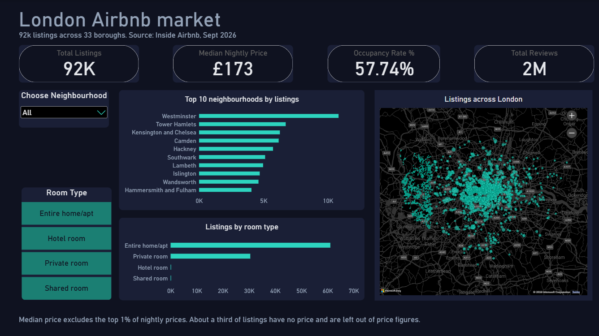
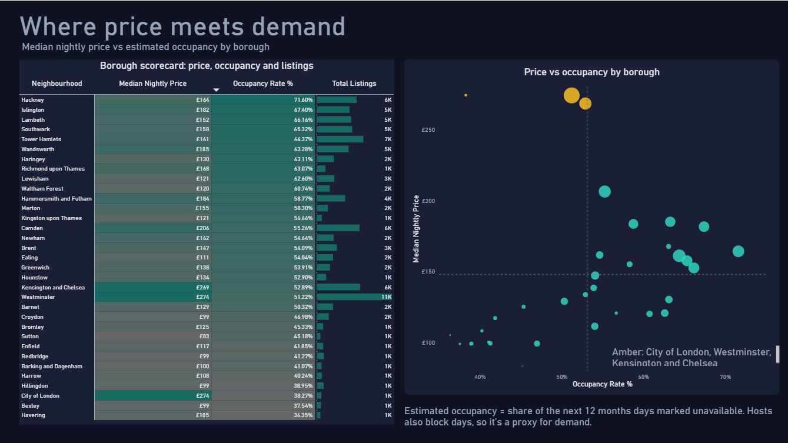
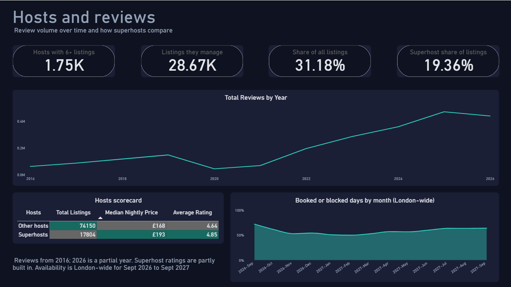

# London Airbnb Market Analysis

A portfolio project that uses **Python (pandas), SQL (PostgreSQL), Excel and Power BI** to study the Airbnb market in London.

**Author:** Razib Khan

## Dashboard preview



- [View the full dashboard as a PDF](images/dashboard.pdf)
- The Power BI file (.pbix) can be downloaded from the **Releases** section of this repository.

## Summary

I analysed 91,954 London Airbnb listings from Inside Airbnb (data collected in September 2026). I wanted to answer practical questions: Where do hosts charge the most? Which boroughs are the busiest? Who controls the supply? Do superhosts really charge more?

The project has four steps: clean the data in pandas, answer 10 business questions in SQL, check the results in Excel, and build a three-page dashboard in Power BI.

## Business questions

1. How many listings are there in each neighbourhood?
2. What is the median price in each neighbourhood?
3. Which room type is the most common?
4. Do superhosts charge more and get better ratings?
5. How many hosts own more than 5 listings, and what share of listings do they control?
6. Which month is the busiest?
7. How has the number of reviews changed over time?
8. Which listings have many reviews but a low rating?
9. What is the estimated occupancy rate in each neighbourhood?
10. Which neighbourhoods have a high price but low occupancy?

## Data

Source: [Inside Airbnb](https://insideairbnb.com/get-the-data/), London, September 2026. The raw files are not included in this repository.

| File | Size | What I used |
|---|---|---|
| Listings | 91,954 rows, 90 columns | 17 columns (price, location, room type, availability, review scores, host information) |
| Calendar | 33,563,890 rows | `listing_id`, `date`, `available` |
| Reviews | one row per review | `id`, `listing_id`, `date` |

## Tools

- **Python (pandas):** data cleaning and summaries
- **PostgreSQL:** analysis with SQL (joins, CTEs, subqueries, percentiles)
- **Excel:** Power Query and a PivotTable to check my SQL results
- **Power BI:** data model, DAX measures and a three-page dashboard

## How I did it

### 1. Cleaning with pandas

- Kept the 17 columns that I needed for the questions.
- Changed `price` from text (for example "$1,250.00") to a number.
- **Missing prices:** 32,049 listings (34.9%) have no price. They have very low availability (about 24 days a year on average, compared with 222 for listings with a price), so many of them are probably inactive. I kept them and added a `price_missing` flag.
- **Outliers:** I flagged the top 1% of prices (above £1,272 per night) with a `price_outlier` flag and did not delete them. The median price is £173 without the outliers and £175 with them, so the middle of the data barely changes.
- **Review scores:** 20,694 listings have no rating. All of them have 0 reviews, so I left them empty and did not fill them with 0.
- Changed `host_is_superhost` from "t" and "f" to True and False.
- Checked for duplicates: every listing ID is unique.
- **Calendar:** the file is too big to load in full, so I loaded only three columns and summarised it: availability per listing, availability per day and availability per month.
- **Reviews:** I counted reviews per month. 10,581 review rows share an ID with another row, but the listing or date is different. There are no exact duplicate rows, so I kept all rows.

### 2. Analysis in PostgreSQL

I loaded the cleaned listings table and the summary tables, then wrote one query for each business question. Occupancy is estimated as `1 - availability_rate`. I used the median for prices because a few extreme prices make the average too high.

### 3. Check in Excel

I loaded the cleaned files with Power Query, merged them, added an occupancy column and built a PivotTable by borough. The listing counts and occupancy rates matched my SQL results.

### 4. Dashboard in Power BI

**Data model**

- `listings` connects to `reviews_clean` and `availability_per_listing` by listing ID.
- A `Calendar` date table (created with DAX) connects to `reviews_clean` and `availability_daily` by date.


**Main measures:** total listings, median nightly price, occupancy rate, total reviews, reviews change vs previous month, hosts with 6+ listings, their share of listings, superhost share, average rating, and booked or blocked rate.

**Pages**

1. **Market overview:** key numbers, top 10 neighbourhoods, room types and a map of listings
2. **Where price meets demand:** a borough table and a scatter plot of price against occupancy
3. **Hosts and reviews:** review trend (drill down from year to month), host concentration, a superhost comparison and seasonal availability

## Key findings

1. **Central boroughs charge the most.** Westminster (£282), City of London (£278) and Kensington and Chelsea (£273) have the highest median prices. The median for all London listings is £175.
2. **Inner east and south London is the busiest.** Hackney (71.6%), Islington (67.4%) and Lambeth (66.2%) have the highest estimated occupancy. Havering has the lowest (36.4%).
3. **Three boroughs have a high price but below-average occupancy:** City of London (£278, 38.3%), Westminster (51.2%) and Kensington and Chelsea (52.9%). City of London is the clearest case.
4. **A third of the supply belongs to big hosts.** 1,752 hosts with more than 5 listings manage 28,671 listings, which is 31.18% of the total.
5. **Superhosts charge about 15% more and rate higher.** Their median price is £194.89 (others: £169.40) and their average rating is 4.85 (others: 4.64). Only about 19% of listings belong to superhosts.

Other results:

- Two thirds of listings are entire homes (66.4%) and one third are private rooms (33.1%). Hotel and shared rooms are only about 0.2% each.
- Reviews fell sharply in 2020 and 2021, which fits the Covid period, and then recovered strongly.
- Availability is lowest in late summer 2027 (July to September), which suggests the strongest demand then. February 2027 has the highest availability.
- Only 11 listings have many reviews (above the 90th percentile) and a rating of 4.0 or below. Very few busy listings are poorly rated.

## Recommendation for a new host

Central boroughs such as Kensington and Chelsea and Westminster have the highest prices, but their occupancy is only around the average. City of London has a similar price with the lowest occupancy of the three, so it looks less attractive. Inner boroughs such as Islington, Hackney and Lambeth combine high occupancy (66% to 72%) with medium prices. A new host should price close to the borough median and aim for the quality of a superhost. These results are indicative and do not include costs.

## Limitations

- The calendar shows the **next 12 months** from the September 2026 scrape. It shows future bookings and days blocked by hosts, not past occupancy.
- Occupancy is an **estimate**: a day marked unavailable may be blocked by the host and not booked by a guest.
- The first and last calendar months are partial, and nearer dates are naturally more booked, so seasonal results are indicative.
- About 35% of listings have no price and are left out of all price figures.
- The Power BI median price excludes the flagged top 1% of prices, so it is a little lower than my SQL results (for example, Westminster is £274 in Power BI and £282 in SQL).
- Reviews are shown from 2016, because earlier years have very few reviews. The latest month is partial.

## Repository structure

```
├── python/    cleaning notebook
├── sql/       queries for the 10 questions
├── excel/     workbook with the PivotTable check
└── images/    dashboard screenshots
```

## Dashboard screenshots




